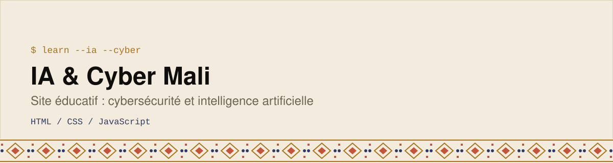

  <picture>
    <source media="(prefers-color-scheme: dark)" srcset="assets/banner-dark.svg">
    
  </picture>

Site web éducatif pour sensibiliser les jeunes, étudiants et professionnels au Mali à la **cybersécurité** et à l’**intelligence artificielle**, avec des exemples tirés du contexte africain.

  

## Pages
- **Accueil** : présentation et objectifs
- **Cybersécurité** : guide complet (menaces, bonnes pratiques)
- **Intelligence artificielle** : guide complet (opportunités, dangers, usages éthiques)
- **Simulateur d’attaque** : scénarios d’apprentissage interactifs, avec résultats et conseils
- **Ressources** et **À propos**

## Contenu rédigé
Le dépôt contient aussi les documents de fond (en Markdown) : menaces et bonnes pratiques de cybersécurité au Mali, arnaques courantes, opportunités et dangers de l’IA, usages éthiques, exemples du contexte africain et principes de design.

## Voir le projet
Le site est statique : ouvre `index.html` dans ton navigateur (ou lance un petit serveur local avec `python3 -m http.server`).

---

Construit par **Emmanuel Elisé Koné** ([BinaryMaoGenius](https://github.com/BinaryMaoGenius)) · *La tech en clair*
